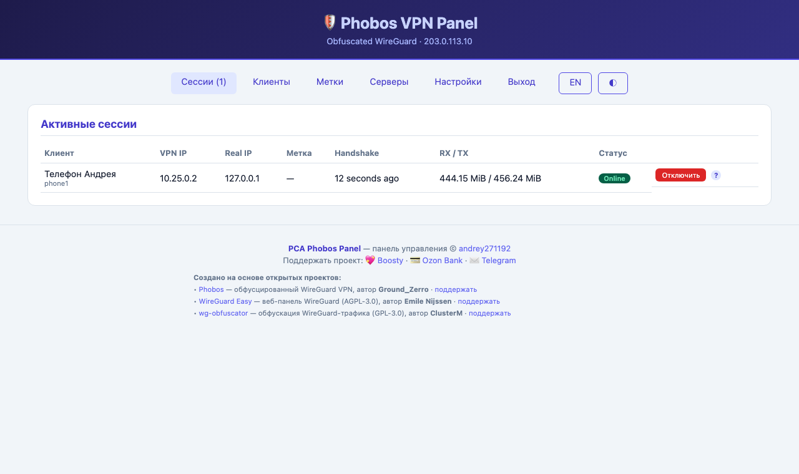
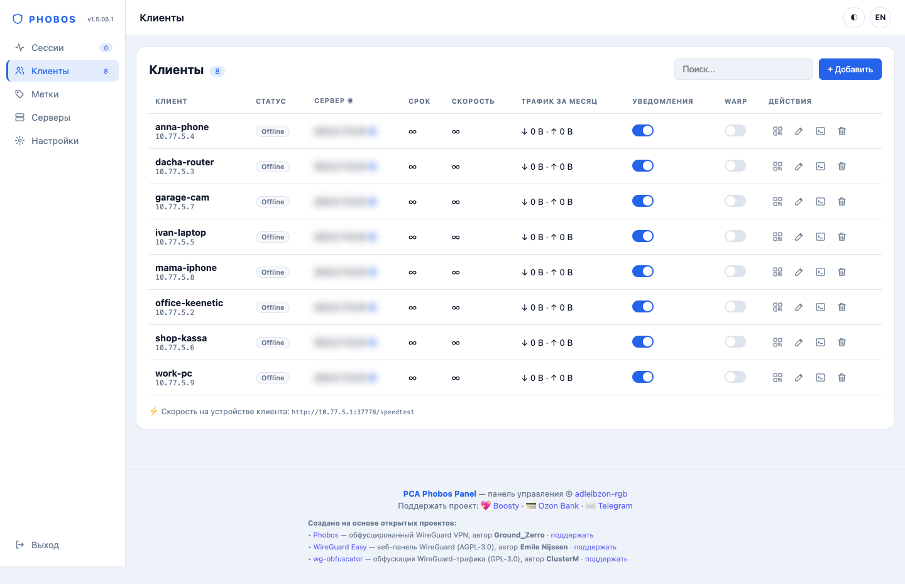
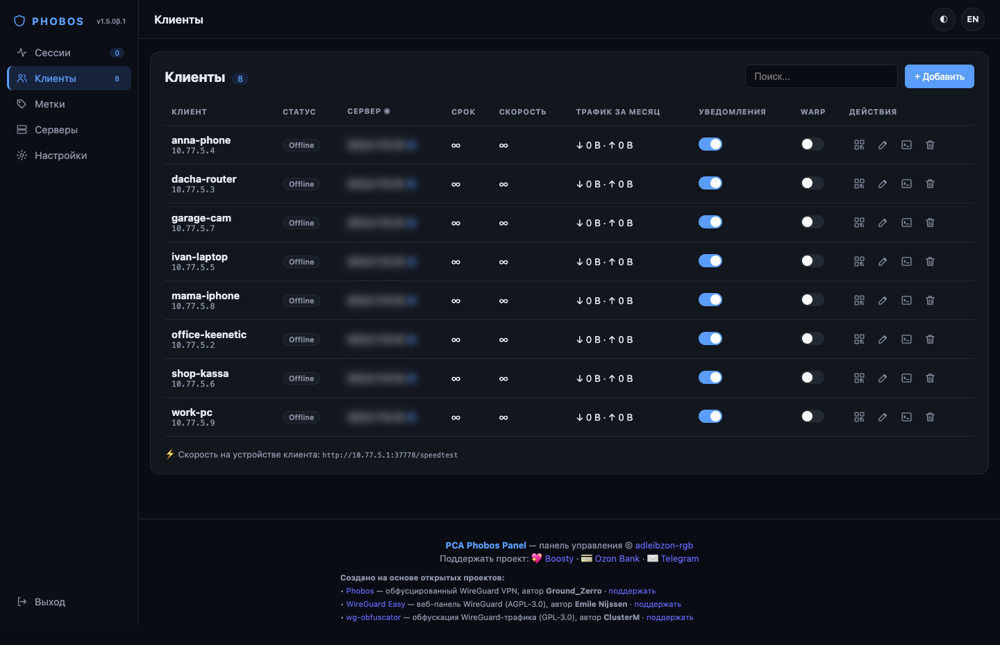
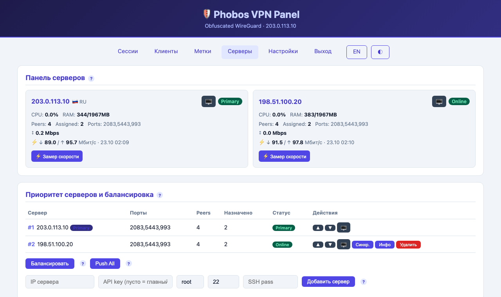
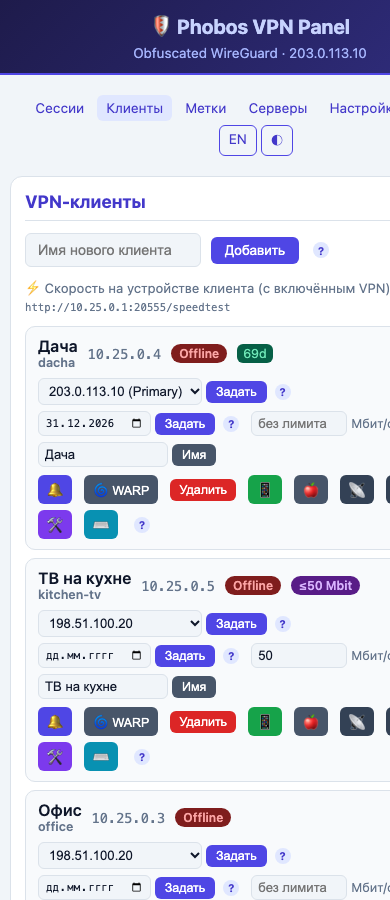
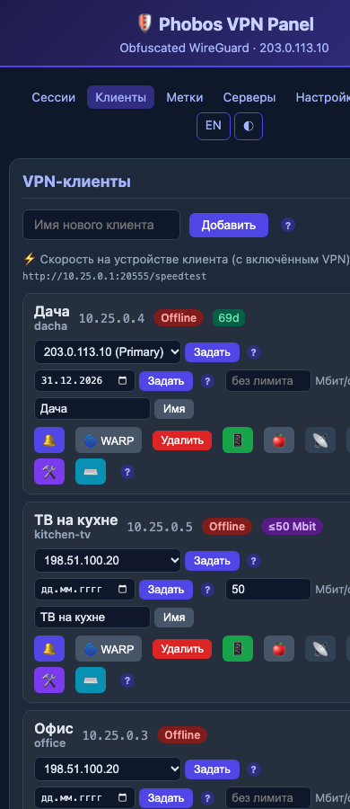
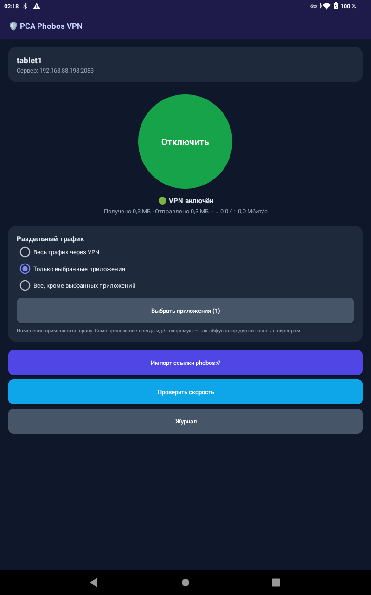
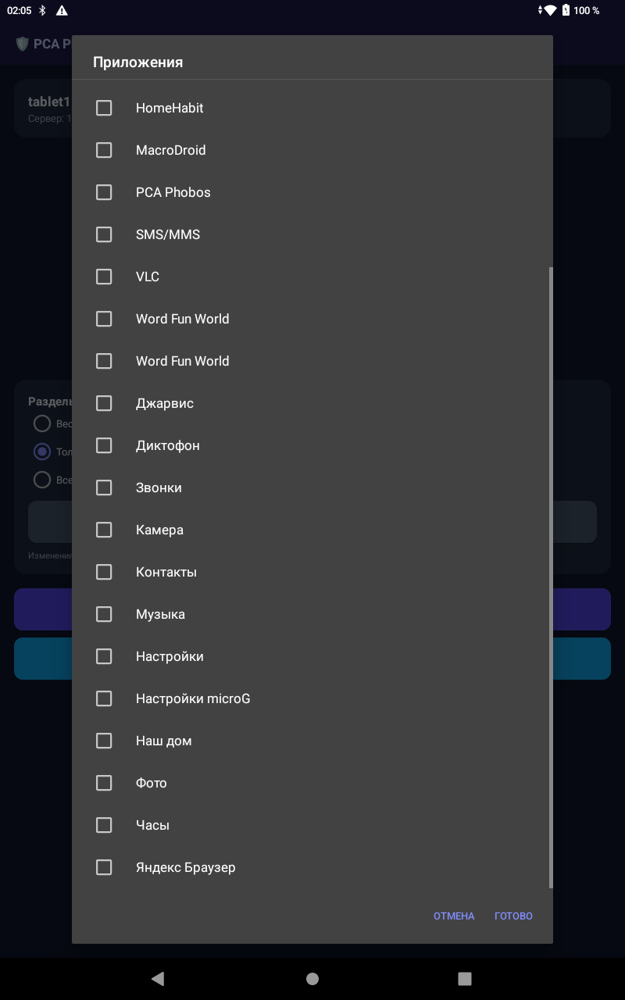
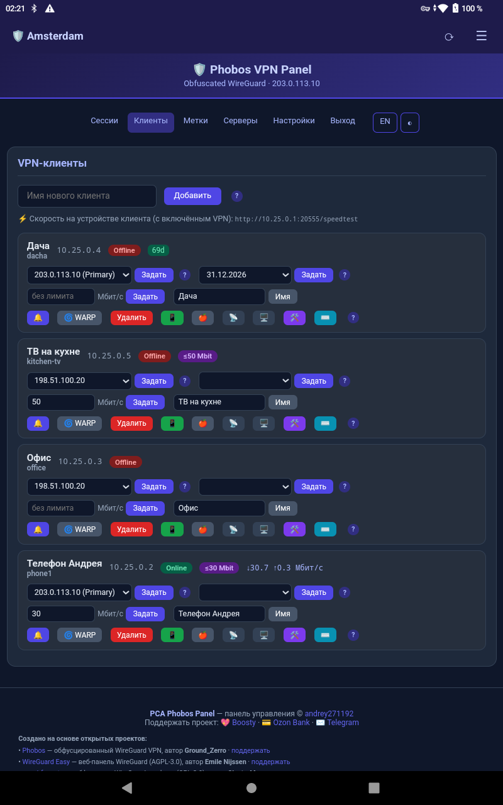

# PCA Phobos — VPN, который не отключается

**Веб-панель и turnkey-установщик для [Phobos](https://github.com/Ground-Zerro/Phobos)** — обфусцированного WireGuard VPN. Ставится на чистый VPS одной командой, управляет десятками роутеров и устройств с одной страницы, сам переключается между серверами при сбоях и восстанавливается после перезагрузок.

<p align="center">
  
</p>

---

## Что это простыми словами

Обычный VPN падает, когда падает сервер или провайдер банит IP. **PCA Phobos — нет.**

- 🌐 **Маскированный WireGuard** — трафик не отличить от обычного, проходит мимо DPI и блокировок по сигнатуре.
- 🔁 **Авто-переключение между серверами** — сервер лёг или порт прикрыли → роутер сам прыгает на резервный за ~10–15 секунд, без твоего участия.
- 📡 **Работает за любым NAT** — серый IP, мобильный интернет, домашний роутер за провайдером. Управление едет внутри самого защищённого туннеля, поэтому бан публичного IP ему не страшен.
- 🖥️ **Одна команда — новое устройство** — создал клиента в панели → вставил команду на роутер → готово.
- ♻️ **Само-восстановление** — роутер перезагрузился, провайдер сменил IP, сервис отвалился → система поднимет всё обратно сама.
- 📱 **Телефоны** — своё приложение **PCA Phobos VPN** для Android (обфускация + раздельный трафик по приложениям), PhobosWG, iPhone (обычный WireGuard) — через QR/ссылку.
- 🛠 **Админ-приложение** PCA Phobos для Android — все ваши панели в одном месте.

---

## Возможности

- **Активные сессии** — VPN IP, Real IP, метка, handshake, трафик RX/TX, Kick.
- **Клиенты VPN** — добавление/удаление, статус online (по handshake на любом сервере), назначение сервера.
- **Мульти-сервер + failover** — приоритеты, балансировка по нагрузке (CPU/RAM + пропускная способность канала), резервные серверы; роутеры переключаются автоматически.
- **NAT-friendly управление** — роутеры сами тянут конфиг по туннелю (`10.25.0.1`), переживает бан публичного IP.
- **Авто-восстановление роутеров** — серверный сторож (watchdog) поднимает роутер после неудачной перезагрузки через KeenDNS.
- **Конфиги для телефона** — 📱 Android `phobos://` + QR, 🍎 iPhone обычный WireGuard + QR.
- **Метки** — имя объекта по IP (видно в сессиях и Telegram).
- **Срок подписки** — дата окончания, обратный отсчёт, автокик + предупреждения.
- **Telegram-уведомления** — подключение/отключение, сервер вверх/вниз, истечение подписки, авто-восстановление.
- **Двуязычный интерфейс** RU/EN + подсказки `?` у каждого действия. **Светлая и тёмная тема** (кнопка ◐), компактная вёрстка — удобно с телефона.
- **Лимит скорости на клиента** — Мбит/с в карточке клиента; работает на всех серверах, сам восстанавливается после перезапуска WireGuard.
- **Замер скорости** — сервера (реальная скачка/отдача, кнопка ⚡ на «Серверах»), клиента (живая скорость в карточке + страница `http://10.25.0.1:<порт>/speedtest` на устройстве через VPN).
- **Домен панели** — `https://ваш-домен/` с бесплатным сертификатом Let's Encrypt; старый адрес `http://IP:порт` продолжает работать.
- **Адрес для клиентов и каскад** — клиенты подключаются по домену или через входной сервер (например, в РФ) → ваш сервер; роутеры получают адрес сами.
- **Резервный TCP-канал** — если провайдер режет UDP, клиент сам переходит на TCP (порт 443), обфускация сохраняется.
- **Канал «Облако»** — если сервер заблокирован целиком: телефон идёт через облако KeenDNS своего Keenetic. [Инструкция](docs/cloud.md).
- **Сторож** — блокировка зондов и сканеров РКН (nftables, список обновляется раз в сутки).
- **WARP / WARP+** — выпуск клиентов в интернет через Cloudflare WARP (всем или выборочно), relay-режим.
- **Бэкап и восстановление** сервера из панели; **терминал роутера в браузере** (ttyd/RCI) за NAT.
- **Версии и обновления** — обновление и откат прямо из панели.
- **Уведомления per-client** — 🔔 у каждого клиента: включить/выключить Telegram-оповещения о подключении/отключении.
- **Telegram-бот** — управление клиентами командами прямо из чата:
  - `/add <имя>` — создать клиента (бот пришлёт команду установки)
  - `/del <имя>` — удалить клиента
  - `/list` — список клиентов
  - **Кнопки** — постоянная клавиатура: ➕ Создать клиента · 📋 Список · 🗑 Удалить (инлайн-выбор) · 📊 Статус · ❓ Помощь.
  (Работает только для чата из настроек `tg_chat_id`.) Бот **необязателен**: хочешь — впиши токен от @BotFather и свой chat id в «Настройки», не хочешь — оставь пустым.

---

## Скриншоты

| Клиенты (светлая) | Клиенты (тёмная) |
|---|---|
|  |  |
| **Сессии** | **Серверы: замер скорости, второй сервер** |
|  |  |

| Телефон: панель | Телефон: тёмная | Android: VPN-клиент | Android: раздельный трафик | Android: админ-приложение |
|---|---|---|---|---|
|  |  |  |  |  |

Настройки (домен, каскад, сторож, WARP, бэкап): [светлая](docs/img/settings.png) · [тёмная](docs/img/settings-dark.png)

--------|---------|---------|
|  |  |  |

> Если картинки не отображаются — положи свои PNG в `docs/img/` (`sessions.png`, `clients.png`, `servers.png`).

---

> **Источник с 23.10.2026:** `git.bobyrev.com/PCA/PCA_Phobos` (GitHub-аккаунт временно недоступен). Серверы на 1.2.x обновляются одной командой:
> ```bash
> bash <(curl -fsSL https://git.bobyrev.com/PCA/PCA_Phobos/raw/branch/main/update.sh)
> ```

## Быстрый старт (с чистого VPS, одной командой)

Ставит **всё** со всеми зависимостями: wg-obfuscator, WireGuard, обфускатор-сервисы, веб-панель, nginx, скрипты онбординга роутеров, сторож авто-восстановления. Предустановленный Phobos **не требуется**.

```bash
bash <(curl -fsSL https://git.bobyrev.com/PCA/PCA_Phobos/raw/branch/main/install.sh)
```

### С параметрами

```bash
PANEL_PASS=МойПароль TG_TOKEN=123:abc TG_CHAT=123456789 \
bash <(curl -fsSL https://git.bobyrev.com/PCA/PCA_Phobos/raw/branch/main/install.sh)
```

| Переменная        | По умолчанию    | Описание |
|-------------------|-----------------|----------|
| `PANEL_PASS`      | `OcAdmin2026!`  | Пароль панели (логин `admin`) |
| `PANEL_PORT`      | случайный       | Порт веб-панели |
| `SERVER_WG_IPV4_NETWORK` | `10.25.0.0/16` | Подсеть VPN-клиентов (например `10.25.1.0/24`). Без переменной установщик спросит в терминале. Сервер получает первый адрес (`10.25.1.1`). Задаётся только при установке |
| `API_KEY`         | случайный       | Общий ключ (агенты + pull-токен роутеров) |
| `OBF_PORTS`       | `2083,5443,993` | Порты обфускатора |
| `TG_TOKEN`/`TG_CHAT` | пусто        | Telegram-уведомления |
| `ALLOW_PLAIN_WG`  | пусто           | `=1` открыть порт 51820 для iOS WireGuard (без обфускации) |
| `PANEL_TLS_CERT` / `PANEL_TLS_KEY` | пусто | Включить HTTPS для панели через свой сертификат |

После установки панель напечатает адрес, логин, пароль и **API key** — сохрани их.

Полный список портов и что можно закрывать: [docs/PORTS.md](docs/PORTS.md).

### Вторичный сервер (для failover / балансировки)

```bash
MAIN_PROTO=http MAIN_SERVER=<ip_основного> MAIN_PORT=<порт_панели> MAIN_API_KEY=<API key из основного> \
bash <(curl -fsSL https://git.bobyrev.com/PCA/PCA_Phobos/raw/branch/main/server/secondary-setup.sh)
```

Сервер сам зарегистрируется в панели, клиенты досылаются на него сразу. Если сервер за NAT — добавь `SERVER_IP=<внешний_ip>`.

### Каскад (вход в РФ → выход за рубежом)

На входном VPS (чистый Debian/Ubuntu, Phobos не нужен):

```bash
bash <(curl -fsSL https://git.bobyrev.com/PCA/PCA_Phobos/raw/branch/main/server/phobos-cascade.sh) enable <IP_выходного_сервера> 2083,5443,993
```

Затем в панели выходного сервера → **Настройки → Адрес для клиентов и каскад** → впиши IP/домен входа. Роутеры переключатся сами (~15 с), телефонам — заново открыть ссылку/QR. Отключить: `phobos-cascade disable`.

### Сторонние «сторожа» по просьбам участников

- Защита от зондов РКН ([Loorrr293/Auto_IPtables](https://github.com/Loorrr293/Auto_IPtables)) — **встроена**: «Настройки → Защита сервера», включается кнопкой.
- «Прикрывашка» ([miha75vu-bit/Flashkeen](https://github.com/miha75vu-bit/Flashkeen)) — WARP на выход + Psiphon; интерактивная, ставится по SSH: `bash <(curl -fsSL https://raw.githubusercontent.com/miha75vu-bit/Flashkeen/main/wp)`. Перестраивает выход wg0 — не включай одновременно со встроенным WARP egress.
- ipidea-kimwolf-ban — репозиторий автора удалён (404), встроить нечего.

---

## Приложения для Android

- **PCA Phobos VPN** — клиент: включает VPN одной кнопкой, импорт `phobos://` из панели, встроенный обфускатор, **раздельный трафик** (весь / только выбранные приложения / все кроме выбранных), **российские сайты напрямую** (по умолчанию), **канал Авто/UDP/TCP/Облако** (при блокировке UDP — сам на TCP), журнал, проверка скорости. [Скачать APK](https://git.bobyrev.com/PCA/PCA_Phobos/releases/download/v1.4.4/PCA-Phobos-VPN.apk) · исходники `android-client/`.
- **PCA Phobos** (админ) — список ваших панелей, открываются в приложении. [Скачать APK](https://git.bobyrev.com/PCA/PCA_Phobos/releases/download/v1.4.4/PCA-Phobos.apk) · исходники `android/`.

## Клиенты для телефона

В таблице **Клиенты** у каждого клиента есть кнопки:

- 📱 **Android** — `phobos://`-ссылка + QR для приложения **PhobosWG** (с обфускацией). Скан QR → импорт.
- 🍎 **iPhone / iOS** — обычный WireGuard-конфиг + QR для официального WireGuard (**без** обфускации). Требует открытого порта 51820 (`ALLOW_PLAIN_WG=1` при установке).

> Для каждого устройства создавай **отдельного клиента** (свой ключ и IP). Один конфиг на двух устройствах = конфликт ключей.

**Приложения:**
- **Android (PhobosWG):** кнопка «Скачать приложение PhobosWG (APK)» на странице Android-клиента. Можно положить свой `.apk` в `/opt/Phobos/www/app/PhobosWG.apk` — тогда панель раздаёт его.
- **iPhone (iOS):** официальный [WireGuard из App Store](https://apps.apple.com/app/wireguard/id1441195209) — кнопка есть на странице iOS-клиента.

---

## Обновление и откат

Проект версионируется (см. файл `VERSION` и git-теги `vX.Y.Z`).

**Из панели:** Настройки → «Версия и обновления» → **Обновить** / **Откатить**.

**Из консоли:**

```bash
phobos-update              # обновить до последней версии (stable)
phobos-update beta|dev     # каналы для подписчиков (GH_TOKEN), сейчас = та же 1.4.0
phobos-update v1.1.0       # обновить до конкретной версии (git tag)
phobos-update --rollback   # откатить на предыдущую версию
phobos-update --version    # показать установленную и доступную версию
phobos-update --list       # список бэкапов
```

Обновляется только слой панели и скриптов. **Ключи WireGuard, `server.env` и клиенты не трогаются.** Перед каждым обновлением делается бэкап → откат восстанавливает его.

---

## Возможные проблемы и решения

| Симптом | Причина | Решение |
|---------|---------|---------|
| **Команда установки → 403 / не качается** | репозиторий приватный | Сделай репозиторий публичным, либо ставь с токеном: `GH_TOKEN=ghp_xxx bash <(curl -fsSL -H "Authorization: token ghp_xxx" .../install.sh)` |
| **Панель не открывается** | панель перезапускалась (обновление) / сервер недоступен | Подожди 5 сек, обнови страницу. Проверь: `systemctl status phobos-panel` |
| **Клиент Offline, хотя работает** | роутер на резервном сервере | Норма — статус считается по handshake на **любом** сервере; обнови страницу |
| **«SSH timeout» при тесте роутера** | роутер за NAT, входящий SSH закрыт | Это нормально — управление идёт по pull-каналу через туннель, SSH не нужен |
| **У роутера нет интернета на LAN-устройствах** | WG-интерфейс `private` / нет привязки устройства к политике | На роутере: `security-level public` + `ip hotspot host <mac> policy <PolicyName>`; health-скрипт чинит это сам в течение ~5 мин |
| **Роутер не поднялся после перезагрузки** | Entware/USB не запустил автозагрузку | Сторож (watchdog) поднимет за ~3 мин (нужны KeenDNS + web-логин роутера в `router_access`), либо перезагрузи роутер ещё раз |
| **iPhone не подключается по `phobos://`** | на iOS нет приложения-обфускатора | Используй 🍎-конфиг (обычный WireGuard) + открой 51820 (`ALLOW_PLAIN_WG=1`) |
| **Смена сервера применяется не сразу** | роутер тянет конфиг по cron | Применяется за ~12–15 сек, не мгновенно |
| **Забыл порт панели** | случайный порт | `cat /opt/phobos-panel/.port` |
| **Забыл API key** | | `grep server_api_key /opt/phobos-panel/settings.json` |
| **Домен: certbot failed** | A-запись не на этот сервер / закрыт 80 | `dig +short домен` = IP сервера; открой 80/tcp; повтори в «Настройках» |
| **Лимит скорости не действует** | wg0 перезапущен | панель сама восстановит за ≤1 мин; вручную: `phobos-limit.sh apply` |
| **Кнопки клиента «уезжают»** | старая версия | обнови до 1.4.0 — карточки клиентов компактные, телефоны тоже |

Логи: `journalctl -u phobos-panel -n 50` · сторож: `/opt/Phobos/server/watchdog.log` · роутер: `/opt/etc/Phobos/health.log`.

---

## Архитектура

```
Телефон/Роутер → wg-obfuscator (клиент) ──обфускация──► сервер :2083/5443/993
                                                              │ де-обфускация
                                                         WireGuard :51820
                                                              │ 10.25.0.x
                                                   ┌──────────┴──────────┐
                                              Веб-панель            Failover на
                                              (Flask+Gunicorn)      резервные серверы
```

- Протокол: **WireGuard + wg-obfuscator** (обфускация от DPI).
- Управление роутерами — по **туннелю** (`10.25.0.1`), устойчиво к бану публичного IP.
- Состояние: JSON-файлы (без БД).

---

## Поддержка проекта

Если PCA Phobos оказался полезен — буду благодарен за поддержку:

- 💖 **Boosty:** [boosty.to/andrey27/donate](https://boosty.to/andrey27/donate)
- 💳 **Ozon Bank (СБП):** [ссылка](https://finance.ozon.ru/apps/sbp/ozonbankpay/019dc200-2a5d-7931-a619-782d285f6798)
- ✉️ **Telegram:** [@PCAdministration](https://t.me/PCAdministration) — вопросы, баги, идеи

## На основе и благодарности

PCA Phobos — это веб-панель и turnkey-инсталлятор поверх отличных открытых проектов:

- [**Phobos**](https://github.com/Ground-Zerro/Phobos) — обфусцированный WireGuard, автор **Ground_Zerro**. Поддержать: [Boosty](https://boosty.to/ground_zerro) ❤️
- [**WireGuard Easy**](https://github.com/wg-easy/wg-easy) — веб-панель WireGuard (AGPL-3.0), автор **Emile Nijssen**. Поддержать: [GitHub Sponsors](https://github.com/sponsors/WeeJeWel) ❤️
- [**wg-obfuscator**](https://github.com/ClusterM/wg-obfuscator) — обфускация WireGuard-трафика (GPL-3.0), автор **ClusterM**. Поддержать: [Boosty](https://boosty.to/cluster) ❤️

Спасибо авторам за отличные инструменты.
