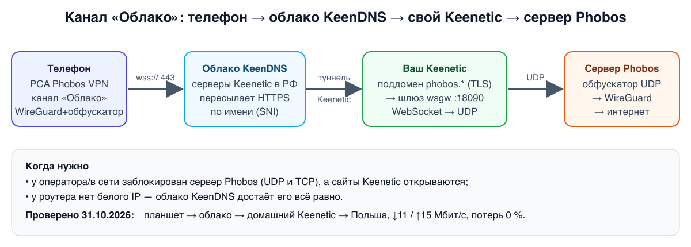
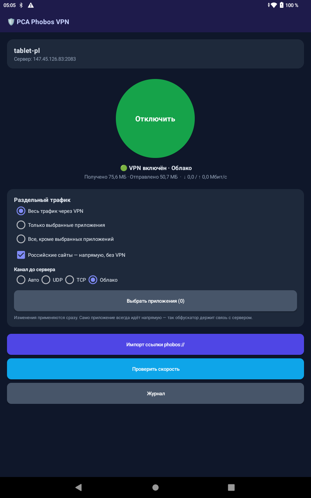
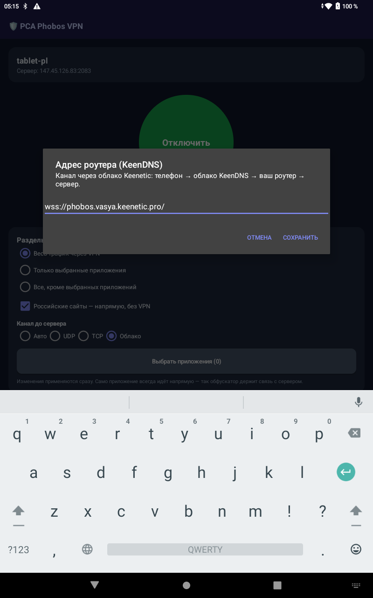
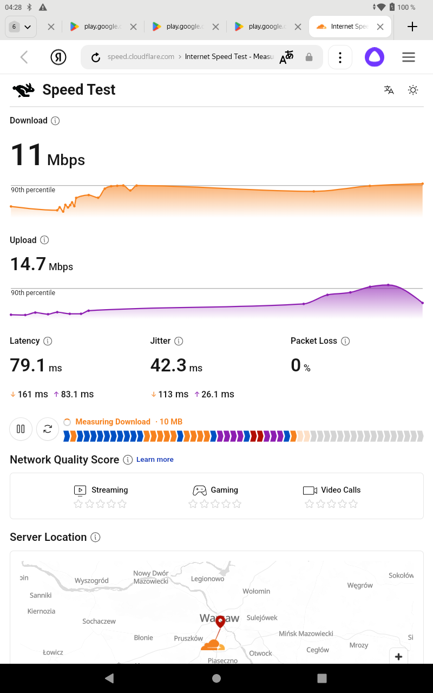

# Канал «Облако» — VPN через облако своего Keenetic (PCA Phobos 1.4.4)



## Что это и зачем
Обычно телефон ходит к серверу Phobos напрямую по UDP (или по резервному TCP). Если оператор или сеть
режет сам сервер, а сайты Keenetic открываются, можно пойти **через свой домашний Keenetic**:

1. телефон открывает защищённый WebSocket `wss://phobos.<имя>.<домен>/` — для оператора это обычный HTTPS к облаку Keenetic;
2. облако KeenDNS (серверы Keenetic в РФ) по имени пересылает соединение в ваш роутер — белый IP роутеру не нужен;
3. на роутере шлюз **wsgw** разворачивает WebSocket обратно в UDP и шлёт на обфускатор сервера Phobos;
4. дальше всё как обычно: WireGuard → интернет с IP сервера.

Это **дополнение** к UDP/TCP, не замена. Шифрование то же (WireGuard), облако Keenetic видит только зашифрованный поток.

**Адрес вида `wss://phobos.vasya.keenetic.pro/`** = `wss://` (WebSocket через HTTPS, порт 443) +
`phobos` (поддомен веб-приложения на роутере) + `vasya.keenetic.pro` (KeenDNS-имя роутера).

Скорость в нашем тесте (Keenetic → сервер в Польше): ↓11 / ↑15 Мбит/с, задержка ~80 мс, потерь 0 %.

---

## Часть 1. Роутер Keenetic (один раз)

**Что нужно:** Keenetic с KeenDNS-именем (Интернет → Доменное имя), установленный Entware (OPKG) и SSH.
Команды ниже — в SSH роутера (`ssh root@192.168.1.1 -p 222` или как у вас настроено).

### Шаг 1. Веб-интерфейс на порт 80
Роутер выпускает сертификат Let's Encrypt для поддомена, только если его веб-интерфейс на порту 80.
```sh
ndmc -c 'ip http port 80'
```
Если раньше был другой порт (81, 8080…) — поправьте закладки и скрипты, которые туда ходили.
Снаружи порт 80 пробрасывать не нужно.

### Шаг 2. Шлюз wsgw
Узнать архитектуру:
```sh
uname -m        # aarch64 → wsgw-aarch64;  mips → wsgw-mipsel (или wsgw-mips, если не запустится)
```
Скачать прямо на роутер (замените `aarch64` на свою архитектуру):
```sh
curl -fsSL -o /opt/sbin/wsgw https://git.bobyrev.com/PCA/PCA_Phobos/raw/branch/main/wsgw/bin/wsgw-aarch64
curl -fsSL -o /opt/etc/init.d/S80wsgw https://git.bobyrev.com/PCA/PCA_Phobos/raw/branch/main/wsgw/router/S80wsgw
chmod +x /opt/sbin/wsgw /opt/etc/init.d/S80wsgw
```
Настройка — файл `/opt/etc/wsgw.conf`:
```sh
cat > /opt/etc/wsgw.conf <<'EOF'
WSGW_LISTEN=192.168.1.1:18090
WSGW_TARGET=147.45.126.83:2083
EOF
/opt/etc/init.d/S80wsgw start
```
- `WSGW_LISTEN` — LAN-адрес **вашего** роутера (Главная → Домашняя сеть) и порт 18090.
- `WSGW_TARGET` — адрес обфускатора сервера: строка `target = …` из ссылки клиента
  (в панели клиента → 📱 → «показать конфиг»). Для сервера Польша — `147.45.126.83:2083`.

Проверка: `netstat -ltn | grep 18090` — должна быть строка LISTEN.

### Шаг 3. Поддомен и облачный режим KeenDNS
Подставьте своё имя: для `vasya.keenetic.pro` — `<имя>` = `vasya`, `<домен>` = `keenetic.pro`.
```sh
ndmc -c 'ip http proxy phobos'
ndmc -c 'ip http proxy phobos upstream http 192.168.1.1 18090'
ndmc -c 'ip http proxy phobos domain ndns'
ndmc -c 'ip http proxy phobos security-level public'
ndmc -c 'ndns book-name <имя> <домен> cloud'
ndmc -c 'ip http ssl acme get phobos.<имя>.<домен>'
ndmc -c 'system configuration save'
```
То же в веб-интерфейсе: **Сетевые правила → Переадресация → Веб-приложения** (или «Доменное имя → Веб-приложения»):
имя `phobos`, адрес `192.168.1.1`, порт `18090`, доступ **без авторизации**; режим доменного имени — **через облако**.

Сертификат выпускается за 10–60 секунд. Проверить:
```sh
ndmc -c 'ip http ssl acme list' | grep domain      # в списке должен быть phobos.<имя>.<домен>
```
Если его нет, а `ndmc -c 'show acme' | grep get-pending` показывает `yes` — **перезагрузите роутер** и повторите `acme get`.

### Шаг 4. Проверка с любого компьютера
```bash
curl -s -o /dev/null -w '%{http_code}\n' https://phobos.<имя>.<домен>/
```
`426` — всё работает (шлюз ответил «нужен WebSocket»). Ошибка TLS (`internal error`) — см. «Если не работает».

---

## Часть 2. Телефон

### Android (PCA Phobos VPN 1.4.4+)
1. Импортируйте ссылку `phobos://` как обычно.
2. «Канал до сервера» → **Облако**.
3. В окне «Адрес роутера (KeenDNS)» введите `wss://phobos.<имя>.<домен>/` → **Сохранить**.
4. **Подключить**. Статус: «🟢 VPN включён · Облако».




### iPhone (PCA Phobos, TestFlight 1.0 (6) и новее)
1. Импортируйте ссылку `phobos://`.
2. «Канал до сервера» → сегмент **Облако**.
3. В появившемся поле — `wss://phobos.<имя>.<домен>/`.
4. **Подключить** → «VPN включён · Облако».

### Проверка
Откройте speed.cloudflare.com: «Your IP address» должен быть IP сервера Phobos (Польша — 147.45.126.83).



Адрес можно не вводить руками: если в ссылке клиента есть строка `# pca-ws = wss://…`, приложение возьмёт её само
(пока строку добавляет только администратор вручную).

---

## Если не работает

| Что видно | Причина | Что делать |
|---|---|---|
| `acme`: «available only when HTTP port is set to 80» | веб-интерфейс не на 80 | Шаг 1 |
| сертификата нет, `get-pending: yes` | задание ACME зависло | перезагрузить роутер, повторить `acme get` |
| curl: TLS `internal error` | у роутера нет сертификата **или** WAN:443 проброшен на другой компьютер (облако шлёт поддомены на WAN:443) | проверить `acme list`; убрать проброс 443 или настроить на том компьютере прокси поддомена на `роутер:18090` (например, Caddy: `phobos.<имя>.<домен> { reverse_proxy 192.168.1.1:18090 }`) |
| curl: `403` | поддомен не `public` / облачный режим выключен | `security-level public`, `ndns … cloud` |
| curl: `502` | шлюз не запущен | `/opt/etc/init.d/S80wsgw start`, проверить `wsgw.conf` |
| VPN «включён · Облако», но сайты не открываются | неверный `WSGW_TARGET` или профиль от другого сервера | `target` в ссылке клиента = `WSGW_TARGET` |

Журнал приложения (Android → «Журнал»): строки `ws: connected …` / `ws up: …` / `ws down: …`.

## Как выключить
```sh
/opt/etc/init.d/S80wsgw stop
ndmc -c 'no ip http proxy phobos'
ndmc -c 'ndns book-name <имя> <домен> direct'
ndmc -c 'system configuration save'
```

## Для разработчика
Код: `wsgw/` (шлюз, Go), `android-client/src/com/pca/phobos/vpn/WsRelay.java`,
`ios/Tunnel/WsLink.swift` + режим 2 в `pcarelay.c`. Протокол: одно бинарное WS-сообщение = один обфусцированный UDP-пакет.
